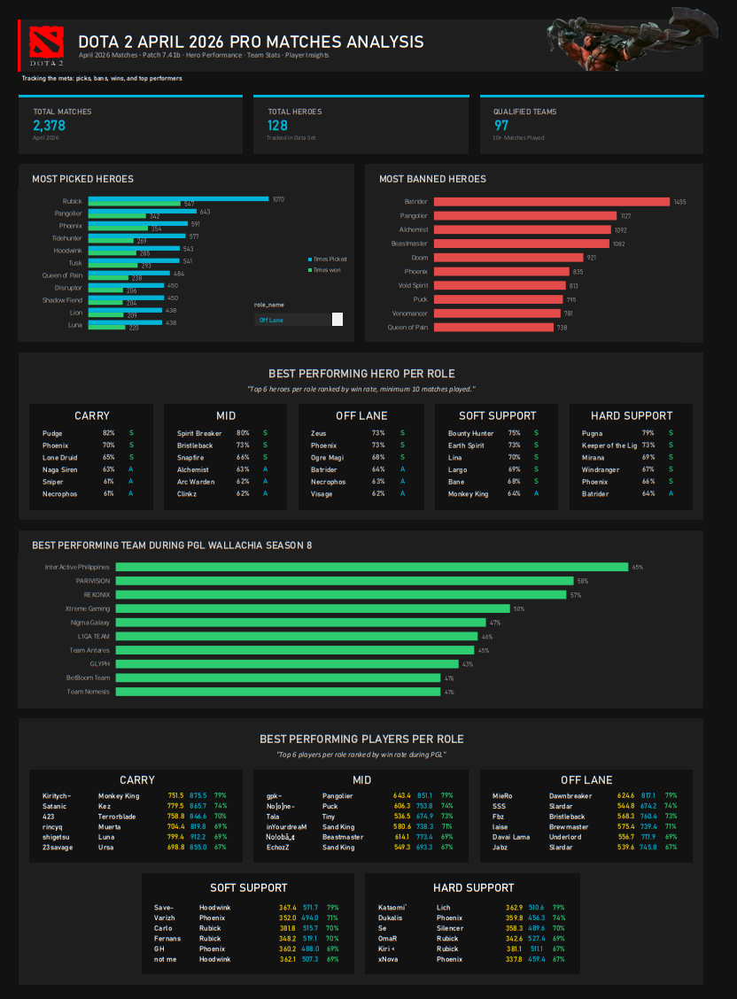

# Dota 2 Pro Match Analysis - PGL Wallachia Season 8

End-to-end data analysis project in **Microsoft Excel**: raw match data cleaned with Power Query and formulas, then turned into an interactive dashboard.

**Dataset:** professional match data from OpenDota for **PGL Wallachia Season 8** (April 16-26, 2026, Bucharest, $1,000,000 prize pool), **Patch 7.41b**. After cleaning: **2,378 matches**, **128 heroes**, **220 players**.

## The question

> Which heroes, teams and players actually perform best at the top level of Dota 2?

## The answer in four lines

1. **Heroes are ranked by more than pick rate.** The tier list (S to D) weighs win rate (50%), pick rate (25%) and ban rate (25%), so a hero that is picked a lot but loses does not rank high.
2. **Top heroes per lane:** the dashboard shows the 6 best heroes in each of the 6 roles (Carry, Mid, Off Lane, Soft Support, Hard Support, Roam) by win rate. [ADD: one or two examples from your dashboard, e.g. the best Carry and the most banned hero.]
3. **Best team:** among the teams with 10+ matches, **InterActive Philippines** had the highest win rate at **65%**.
4. **Best players:** the top 6 players per role are listed with their main hero, win rate, average GPM and average XPM. [ADD: one example, e.g. the best Mid player.]

## Dashboard

[ADD: one sentence describing the screenshot, e.g. "Top picked and banned heroes with a lane slicer, the hero tier list, and the best teams and players."]

### Hero performance
- **Most picked heroes:** top 10 by pick count, filtered by lane with a slicer.
- **Most banned heroes:** top 10 by ban count.
- **Best heroes by role:** top 6 per lane by win rate, with S/A/B/C/D tier badges.
- **Hero tier list:** weighted score of win rate (50%), pick rate (25%) and ban rate (25%).

### Team performance
- **Best performing teams:** top 10 qualified teams by win rate (minimum 10 matches).

### Player performance
- **Best players by role:** top 6 per lane with main hero, win rate, average GPM and average XPM.

## Data

Raw data files are too large for GitHub, so they are on Google Drive.

**In this repo (analysis files):**

| File | What it has |
|------|-------------|
| `dota2_dashboard.xlsx` | The interactive dashboard (dark theme, PivotTables and slicers) |
| `hero_summary.xlsx` | Hero tier list with pick rate, ban rate, win rate and weighted score |
| `team_analysis.xlsx` | Team win rates and player performance summary |
| `hero_reference.xlsx` | Hero ID to hero name lookup table (from the OpenDota API) |

**On Google Drive (raw data):**

| File | What it has |
|------|-------------|
| `players.xlsx` | 24,930 player rows, cleaned and transformed |
| `picks_bans.xlsx` | 59,530 pick and ban actions across all matches |
| `main_metadata.xlsx` | 2,378 cleaned matches |
| `teams.xlsx` | Team information linked to match results |

## Data cleaning

- Removed matches where both teams were `<UNKNOWN>`, and matches where one team was unknown.
- Synced the row counts across the linked files (teams, metadata, players).
- Pulled the hero name reference from the OpenDota API with Power Query.
- Rebuilt the lane and role classification using GPM rank within each match and the `lane_role` field.
- Applied a minimum of 10 matches for a team, hero or player to count as qualified.

## Other findings

- 2,378 clean matches and 128 unique heroes tracked.
- 97 qualified teams (10+ matches) and 220 professional players identified.

## Excel techniques used

| Function | Used for |
|----------|----------|
| `XLOOKUP`, `INDEX / MATCH` | Hero name and stat lookups across files |
| `COUNTIFS`, `AVERAGEIFS` | Pick, ban and win counts; average GPM and XPM |
| `FILTER`, `UNIQUE` | Filtering by lane and qualification; unique hero, team and player lists |
| `SORT / SORTBY`, `LARGE + SEQUENCE` | Rankings and top N extraction |
| `IF / IFS` | Tier assignment and role classification |
| `VSTACK / CHOOSE` | Combining multi-column arrays |
| PivotTables and slicers | Interactive dashboard filtering |
| Power Query | Pulling the hero reference table from the OpenDota API |

## Connect

**Andreij Lacson** - [LinkedIn](https://www.linkedin.com/in/andreij-lacson-464654307) | [GitHub](https://github.com/Dreygggg)

*Data sourced from OpenDota. Tournament: PGL Wallachia Season 8, April 2026. Patch 7.41b.*
